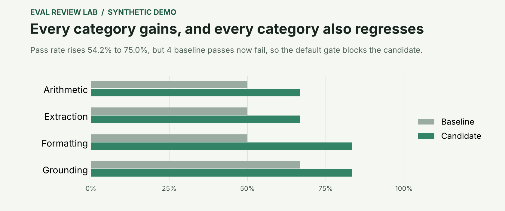
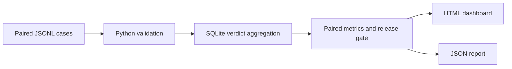

# Eval Review Lab

[](https://github.com/tavialaw7/eval-review-lab/actions/workflows/checks.yml)
[](https://tavialaw7.github.io/eval-review-lab/)

A human-in-the-loop evaluation pipeline for comparing two LLM versions on the same prompts. It turns reviewer verdicts into a release decision and gives reviewers the case-level evidence behind it.

**Demo finding.** The candidate passes 18 of 24 cases versus 13 for the baseline, a gain of **20.8 percentage points** (95% CI −7.4 to +49.1). Four previously passing cases fail, so the default release gate blocks the candidate.

**[Open the live demo](https://tavialaw7.github.io/eval-review-lab/)**, no install needed.

## Why I built this

I do human evaluation and annotation work on LLM projects, where a model's average score can improve while specific answers quietly get worse. I built this to make that visible: pair every prompt, find the regressions, and keep the reviewer evidence one click away. Everything here is synthetic. No data comes from any employer or client.



## Run the demo

Open the [live demo](https://tavialaw7.github.io/eval-review-lab/), or open [docs/index.html](docs/index.html) locally. The demo works offline. In **Case review**, select **Regression** and **Formatting**, then open **ER-015** to inspect the exact prompt, responses, scores, and review notes.

Generate a fresh report with Python 3.10 or later. The project uses the Python standard library, SQLite, and browser-native JavaScript. It requires no API keys or package installs.

```bash
python3 -m eval_review data/example.jsonl
python3 -m unittest discover -s tests -v
```

Or install the CLI with `pip install .` and run `eval-review data/example.jsonl`.

Open `build/index.html` for the dashboard. Use `build/report.json` to consume the same metrics and case details in another tool.

```bash
python3 -m eval_review data/example.jsonl --enforce-gate
```

This example exits **1** after writing the reports because the gate blocks the release. With `--enforce-gate`, exit **0** means the gate passed. Without enforcement, exit **0** means the report generated successfully. Invalid arguments, malformed input, and I/O failures exit **2**.

## How it works



| Metric | Definition |
| --- | --- |
| Variant pass | Both reviewers mark the response as passing. The three rubric scores remain available for diagnosis. |
| Regression | A case the baseline passes and the candidate fails. An improvement is the reverse. |
| Change | Candidate pass rate minus baseline pass rate in percentage points. |
| Reviewer agreement | Fraction of baseline and candidate responses with matching binary verdicts. Cohen’s κ is reported for a consistent reviewer pair when defined. |
| 95% interval | Wald interval for the paired pass-rate change, in percentage points. It is wide at 24 cases. |
| Exact McNemar p-value | Two-sided paired comparison of improvement and regression counts. The release gate uses the configured thresholds independently. |
| Release gate | The regression count must be at most `--max-regressions` (default 0), and the pass-rate change must be at least `--min-delta-pp` (default 0). |

Each JSONL line contains one case with `id`, `category`, `prompt`, `baseline`, and `candidate`. Each variant holds a `response` and two reviews from distinct reviewer IDs. Each review includes `reviewer`, `verdict` (`pass` or `fail`), `note`, and integer `scores` from 1 to 5 for `accuracy`, `instruction_following`, and `clarity`. See [the example input](data/example.jsonl) and [the rubric](docs/rubric.md).

## Scope and tradeoffs

- The fixture is synthetic. The prompts, responses, and reviews demonstrate the workflow and cannot establish live model quality.
- A split verdict fails the case and stays visible in the dashboard. A team that adjudicates disagreements could add a third-review decision while retaining both original ratings.
- The pipeline evaluates imported reviews. Live model calls, annotation collection, and reviewer assignment are outside its scope.
- Reports embed the full input evidence. Share generated reports only with people authorized to see that evidence.
- GitHub Actions is configured to run the tests and verify that the sample produces both reports and the expected blocked exit status.

[Design decisions and FAQ](docs/design-decisions.md) · [Review rubric](docs/rubric.md)

MIT licensed. Built by [Tavia](https://github.com/tavialaw7).
